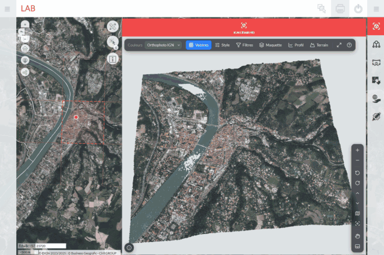

# geo-lidar-hd — LiDAR HD 3D (IGN)



Module GEO qui affiche en 3D le nuage de points **LiDAR HD de l'IGN** à l'endroit cliqué sur la carte, trace des
profils en travers et exporte le terrain ou les points en DXF, directement depuis une application GEO.

- **Identifiant** : `geo.lidar.hd`
- **Version** : 1.1.2
- **État** : essayé sur un serveur GEO. Voir les [limites connues](#limites-connues)
- **Données** : services publics de l'IGN (nuages de points, MNT, MNS, orthophotos) et cadastre diffusé par Etalab.
  Le module n'a pas de serveur : le navigateur lit directement ces données

Projet communautaire indépendant, non affilié à Business Geografic.

## Sommaire

- [Ce que permet le module](#ce-que-permet-le-module)
- [Installation](#installation)
  - [Prérequis GEO API v2](#prérequis-geo-api-v2)
- [Réglages du Générateur](#réglages-du-générateur)
- [Accès réseau nécessaires](#accès-réseau-nécessaires)
- [Limites connues](#limites-connues)
- [Développement](#développement)
- [Licence](#licence)

## Ce que permet le module

Un onglet de la barre latérale droite ouvre un panneau 3D. Un clic sur la carte GEO charge la dalle de 1 km² à cet
endroit, puis les 8 dalles voisines en arrière-plan : un anneau bleu autour du badge « i » en montre l'avancement.

| Outil | Ce qu'il fait |
|---|---|
| **Couleurs** | Orthophoto, classification, altitude, hauteur au-dessus du sol |
| **Voisines** | Charge ou retire les 8 dalles autour de la dalle cliquée, avec un budget de points commun |
| **Style** | Forme et taille des points, atténuation, gamma, opacité, niveau de détail, budget, fond |
| **Filtres** | Tranche d'altitude, tranche de hauteur au-dessus du sol, classes visibles (vue 3D et profil) |
| **Maquette** | Surface pleine d'après le MNT et le MNS, du terrain nu à la surface, exagération du relief |
| **Profil** | Coupe le long d'un tracé sur la carte GEO : courbes MNT et MNS, pentes, mesures, cadastre, exports PNG, CSV et DXF |
| **Terrain** | Export d'une emprise dessinée sur la carte : terrain en faces 3D (DXF), cadastre, orthophoto en GeoTIFF, points du nuage (DXF) |

Autres fonctions :

- **Pointage** : un clic sur un point donne son altitude NGF, sa classe et ses coordonnées dans les projections proposées.
- **Cadastre dans le profil** : limites de parcelles et bâti sur le graphique. Le curseur et les mesures s'y accrochent.
  Tracé indicatif, sans valeur juridique, et absent des exports du profil.
- **Passage d'un outil à l'autre** : Profil et Terrain gardent leur tracé en mémoire.
- **Module masqué** : en le rouvrant, on retrouve la vue, les réglages et les tracés, jusqu'au rechargement de la page.
  Un export en cours continue.
- **Visites guidées** : un bouton `?` présente Style, Filtres, Maquette, Profil et Terrain, à la demande.
- **Nouveautés** : le bouton d'aide `?` de la barre d'outils donne accès à la navigation 3D et au journal des versions.

## Installation

1. Télécharger le ZIP (`geo-lidar-hd_AAAAMMJJ-HHMM.zip`) depuis la
   [dernière version publiée](https://github.com/vienne-condrieu-agglomeration/geo-module-lidar-hd/releases/latest),
   ou le construire : `npm install`, puis `npm run package`.
2. Dans le Générateur, menu Modules, « + Module », glisser le ZIP. **Pour un premier import, utiliser l'ancienne
   interface** : le premier import par la nouvelle interface n'a pas encore été confirmé. Une mise à jour par la
   nouvelle interface a fonctionné pour d'autres modules sur GEO 4.5.0.
3. Ajouter le module à l'application, renseigner ses réglages si besoin, puis publier l'application.

L'envoi direct au serveur (`npm run publish`) n'est pas disponible pour ce module.

### Prérequis GEO API v2

**L'application doit comporter le module GEO API v2 de la plateforme**, à ajouter dans le Générateur. Le module déclare
cette API en dépendance fixe : sans elle, c'est toute l'application qui risque de ne plus démarrer, avec une erreur
`[$injector:nomod] … bg.common.geo.GeoApi` dans la console. Dans ce cas, retirer le module ou ajouter GEO API v2.

## Réglages du Générateur

| Clé | Rôle | Défaut |
|---|---|---|
| `wfsUrl` | WFS des dalles | `https://data.geopf.fr/wfs` |
| `pointBudget` | Points affichés simultanément, toutes dalles confondues | 2 000 000 |
| `neighbourTiles` | Charger les 8 dalles voisines en arrière-plan (valeur par défaut du bouton « Voisines ») | oui |
| `orthoEnabled` | Colorer les points par orthophoto (mode « Orthophoto ») | oui |
| `orthoWmsUrl` | WMS d'orthophotos pour colorer les points (vide = WMS de l'IGN) | `https://data.geopf.fr/wms-r/wms` |
| `orthoLayer` | Couche du WMS d'orthophotos utilisée par défaut ; le panneau « Style » propose les autres couches du service (GetCapabilities, EPSG:2154) | `ORTHOIMAGERY.ORTHOPHOTOS` |
| `orthoMaxSize` | Résolution maximale de l'orthophoto (1024 / 2048 / 4096 px) | 4096 |
| `city3dUrl` | Dossier de base des données 3D de la maquette (prototype : voir `scripts/city3d/README.md`) : `<URL>/buildings/<dalle>.bld` (bâtiments LoD2 reconstruits par roofer) et `<URL>/vegetation/<dalle>.veg` (canopée issue des points classés végétation). Active les cases « Bâtiments LoD2 » et « Arbres » du panneau Maquette, selon les deux interrupteurs ci-dessous (vide = désactivé, comportement inchangé) | vide |
| `buildingsEnabled` | Propose la case « Bâtiments LoD2 » (sans effet si `city3dUrl` est vide) | oui |
| `treesEnabled` | Propose la case « Arbres » : les cônes de la végétation sont remplacés par des arbres en volumes simples (sans effet si `city3dUrl` est vide) | oui |
| `crsList` | Projections proposées (pointage, export du terrain, DXF 3D du profil), séparées par des virgules. La première est le choix par défaut. Codes acceptés : `EPSG:2154`, `EPSG:3942` à `EPSG:3950`, `EPSG:4326` | toutes, Lambert-93 en tête |
| `toolName` | Libellé de l'onglet | LiDAR HD |

## Accès réseau nécessaires

Le poste de l'utilisateur doit pouvoir joindre ces services. Sans accès Internet, le module ne peut pas fonctionner.

| Service | Usage | Obligatoire |
|---|---|---|
| `data.geopf.fr` (IGN) | Dalles, nuages de points, MNT, MNS, orthophotos | oui |
| `apicarto.ign.fr` | Communes pour le cadastre | pour le cadastre |
| `cadastre.s3.rbx.io.cloud.ovh.net` (Etalab) | Cadastre PCI Vecteur | pour le cadastre |

Le serveur de l'IGN limite le débit : le module limite ses requêtes en parallèle et rejoue celles qui sont refusées.

## Limites connues

- **Mémoire** : la vue masquée et le cache de données (250 Mo au plus) restent en mémoire jusqu'au rechargement de la
  page. Un poste modeste peut donc préférer un budget de points plus bas.
- **Cache disque** : les données LiDAR et les rasters déjà lus sont conservés par le navigateur (2 Go au plus, 7 jours),
  y compris après rechargement de la page. L'encart d'informations de la dalle (bouton « i ») en indique la taille et permet de le vider ; une dalle
  republiée par l'IGN n'est revue qu'après ce délai ou après « Vider ».
- **Couverture** : seules les dalles publiées par l'IGN sont disponibles, et une dalle peut être sans MNT.
- **Cadastre** : tracé indicatif, sans valeur juridique ni de bornage. Les fichiers sont lus par commune.
- **Exports volumineux** : à 50 cm, compter 1 à 2 Go de DXF par km² (estimation). Le panneau donne une estimation avant
  l'export. Un navigateur qui ne sait pas écrire directement sur le disque construit le fichier en mémoire.
- **Non testé en conditions réelles** : la perte du contexte 3D pendant le masquage (la dernière dalle est alors
  rechargée), le geste à deux doigts sur un vrai trackpad, une politique de sécurité (CSP) qui bloquerait les workers
  `blob:`, une très mauvaise connexion, et l'ouverture des DXF dans AutoCAD ou Covadis.

## Développement

```bash
npm install
npm run build      # worker, puis dist/main.js
npm test           # versions, calculs du cadastre, visites guidées, projections
npm run package    # build + geo-lidar-hd_AAAAMMJJ-HHMM.zip
```

Fonctionnement interne, vérifications réalisées et pistes d'évolution : [GUIDE-DEV.md](GUIDE-DEV.md).
Journal des versions : [CHANGELOG.md](CHANGELOG.md).

## Licence

- **Code** : [GPL-3.0-or-later](LICENSE) — © 2026 Vienne Condrieu Agglomération.
- **Documentation** (ce README, `CHANGELOG.md`, captures) : [CC-BY-4.0](LICENSE-DOCS).
- **Composants tiers** embarqués dans le bundle (iTowns, three.js, proj4 et leurs dépendances ; icônes Lucide) : voir [THIRD-PARTY-LICENSES.md](THIRD-PARTY-LICENSES.md).
- **Marques** : « GEO » et « Business Geografic » sont des marques de leurs titulaires ; ce module est indépendant et
  n'est ni édité ni approuvé par Business Geografic.

Les contributions se font sous la même licence, avec signature DCO : voir [CONTRIBUTING.md](CONTRIBUTING.md).
